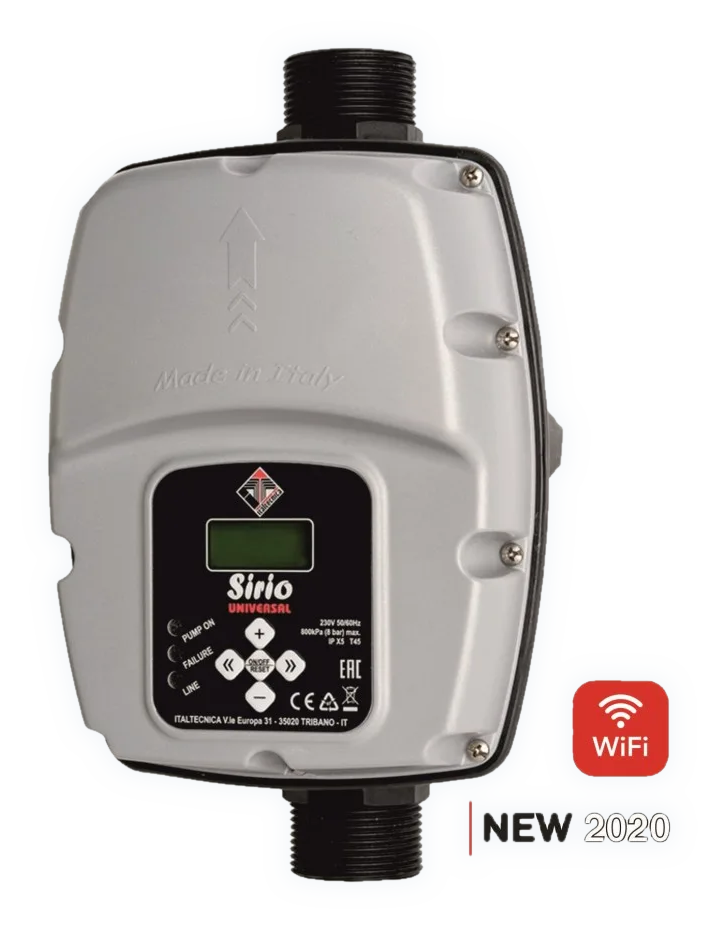
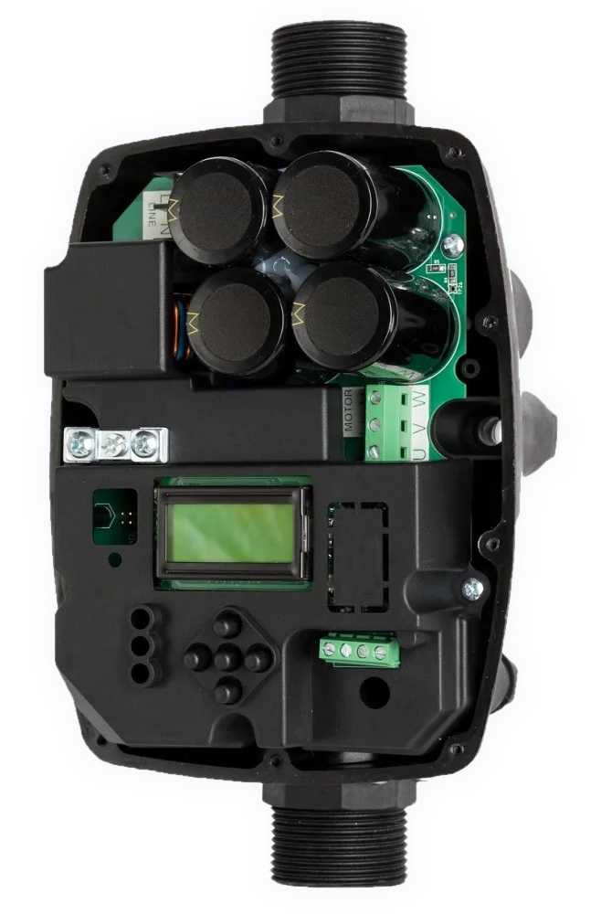
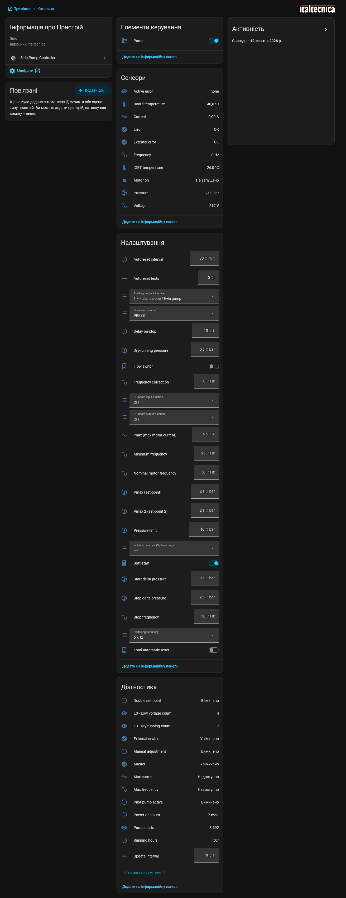

# Italtecnica Sirio Universal for Home Assistant

Local-polling custom integration for **Italtecnica Sirio Universal** frequency pump controllers
(tested on a Sirio Universal; the higher-current **Sirio Universal XP** may work too, but
has not been tested: reports welcome)
(also sold as Uni-Fitt / Wilo Sirio) that have the Wi-Fi web interface
(`/management.html`). No cloud and no extra hardware: Home Assistant talks to the
controller's own web API, the same one its web page uses.

<p align="center">
  
  &nbsp;&nbsp;
  
</p>

Everything shows up as **one device** with sensors, binary sensors and the
controller's *Base Parameters* as settings (numbers, selects, switches).



## Entities

**Sensors:** pressure, frequency, current, voltage, board temperature, IGBT
temperature, active error.
**Diagnostic sensors:** power-on hours, running hours, pump starts, and the
lifetime counters for error codes E0-E13 (disabled by default; enable the ones you want).

**Switch "Pump":** run / stand-by, the same as clicking the green ON / yellow STAND-BY
status icon on the controller's page. The controller only offers a toggle, so the integration
reads the state first, toggles only if needed, and checks the state afterwards. Needs
"Allow changing pump parameters" (see Options).

**Binary sensors:** motor on, error, external error.
**Diagnostic binary sensors:** master, external enable, double set-point, pilot pump
active, manual adjustment.

**Diagnostic number:** update interval (1-300 s, default 10): the same setting as in the
options, applied at once. It belongs to Home Assistant, not the pump, so it can be changed
even while "Allow changing pump parameters" is off.

**Parameters** (entity category *Configuration*), read every 5 minutes and after each change
(a parameter that could not be read yet is retried after 30 seconds):

| Code | Entity | Type | Range / values |
|------|--------|------|----------------|
| 0.0 | Pmax (set-point) | number | 0.5-8 bar |
| 0.1 | Start delta pressure | number | 0.3-8 bar |
| 0.2 | Dry-running pressure | number | 0-8 bar |
| 0.3 | Pressure limit | number | 0-10 bar |
| 0.4 | Pmax 2 (set-point 2) | number | 0.5-8 bar |
| 0.5 | Stop delta pressure | number | 0-8 bar |
| 1.0 | Imax (max motor current) | number | 0.5-16 A |
| 1.1 | Rotation direction (3-phase only) | select | `-->`, `<--` |
| 1.2 | Minimum frequency | number | 10-60 Hz |
| 1.3 | Stop frequency | number | 10-60 Hz |
| 1.4 | Nominal motor frequency | number | 50-60 Hz |
| 1.5 | Switching frequency | select | 3, 5, 10 kHz |
| 1.6 | Frequency correction | number | -5...+5 Hz |
| 1.7 | Soft-start | switch | on/off |
| 2.0 | Flow switch | switch | on/off |
| 2.1 | Command source | select | MAN, 0-10V, PRESS |
| 2.2 | Auxiliary contact function | select | 1 <->, 2 <-, 3 x2 |
| 2.3 | I/O board input function | select | 2 <-, 3 x2, ERR, OFF |
| 2.4 | I/O board output function | select | OFF, ERR, P.ON, AUX |
| 2.5 | Delay on stop | number | 0-60 s, 0.1 s steps |
| 2.6 | Autoreset interval | number | 1-240 min |
| 2.7 | Autoreset tests | number | 0-20 |
| 2.8 | Total automatic reset | switch | on/off |

Not exposed: 0.6 pressure unit (the integration follows the controller's bar/psi
setting automatically) and the *Advanced Parameters* (4.x / 5.x), which need a login on
the controller.

The runtime values "set point", "max current" and "max frequency" are not separate
sensors any more: they are the parameters Pmax, Imax and nominal motor frequency.

## Requirements

* Home Assistant **2025.2 or newer** (uses `runtime_data`, `AddConfigEntryEntitiesCallback` and current config-flow APIs).
* The logo/icon shown for the integration needs **Home Assistant 2026.3 or newer**
  (local `brand/` folder). Older versions just show a placeholder.
* The controller reachable from Home Assistant over HTTP (port 80 by default).

## Install

1. Copy `custom_components/sirio` into your Home Assistant config folder, so you get
   `config/custom_components/sirio/manifest.json`.
2. Restart Home Assistant (a full restart; quick reload does not load new integrations).
3. Settings -> Devices & services -> Add integration -> **Italtecnica Sirio Universal**.
   Enter the controller's IP, port (80 unless you changed it, e.g. behind NAT), a name and the update interval.

HACS: add this repository as a *custom repository* of type *Integration*.

## Options

Settings -> Devices & services -> Sirio -> Configure:

* **Update interval**: 1-300 seconds, default 10. Status is read with one request per cycle.
  Also available as the *Update interval* diagnostic entity on the device.
* **Allow changing pump parameters**: off by default. While off, the Pump switch and the parameter entities
  are read-only and any attempt to change one raises an error. Turn it on to let Home
  Assistant change settings on the controller.

## How parameter changes work

The controller has no "set to value" call. Its web page changes a parameter one step at a
time with the + / - buttons, and each step returns the new value. The integration does the
same: it reads the current value, steps up or down until the target is reached, and checks
every step. It stops with an error if the controller stops changing the value (limit
reached), moves the wrong way, or steps past the target, and then re-reads the real value.

Changing settings affects a real pump. Check the pump's and controller's documentation
before changing frequencies, Imax, rotation direction, switching frequency or the command
source (MAN disables the dry-running and pressure protections).

## Controller web API

All requests are `POST`, form-encoded, to the controller (default `http://<ip>`, port 80):

| Request | Purpose |
|---------|---------|
| `/ajax/get-registers` `key=001` | runtime status (JSON) |
| `/ajax/get-registers` `key=002&index=N` | read base parameter N |
| `/ajax/set-registers` `key=007&index=N` | parameter N one step up |
| `/ajax/set-registers` `key=008&index=N` | parameter N one step down |

The web page polls the status every 200 ms. The integration polls much more slowly and never
overlaps requests, because the controller is a small embedded web server.

## Development

```
python tests/test_api.py          # stepping logic against a simulated controller
python tools/make_brand.py tools/source/italtecnica-logo.png custom_components/sirio/brand
```

The tests stub Home Assistant and aiohttp, so no Home Assistant install is needed.
See `CLAUDE.md` for the design notes and the full register map.

## Credits and trademarks

Italtecnica and Sirio are trademarks of their respective owners. The logo files in
`custom_components/sirio/brand/` are derived from the manufacturer's logo and are used only
to identify the product. This project is not affiliated with or endorsed by Italtecnica.
